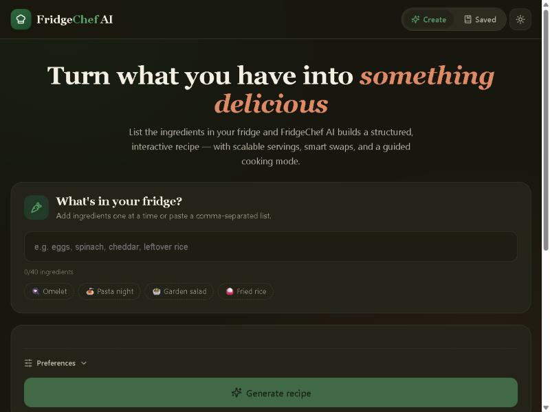
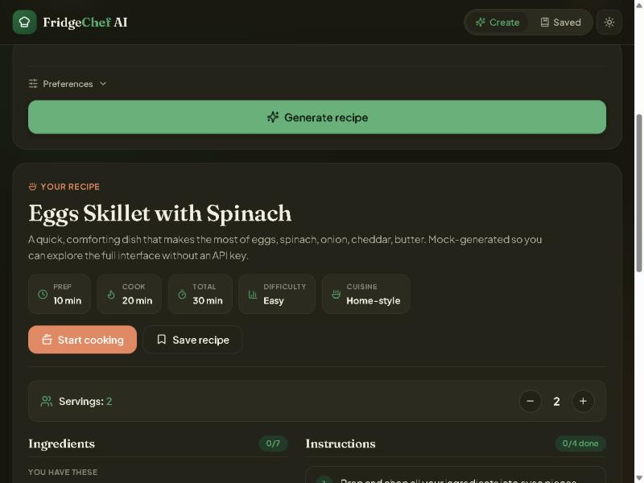
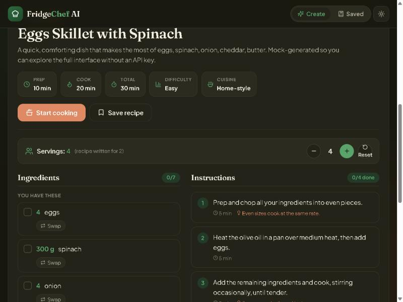
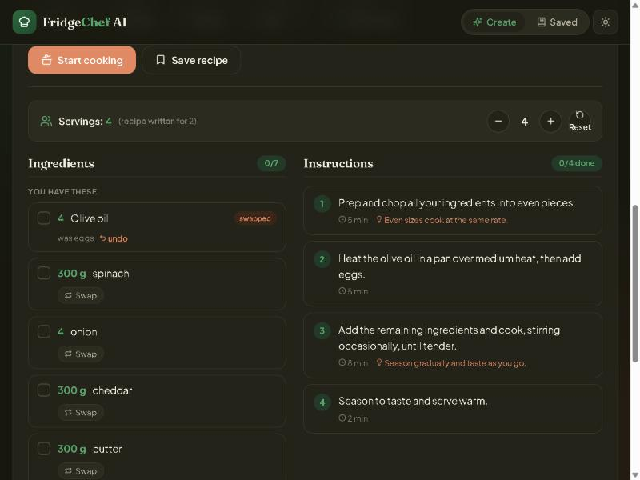
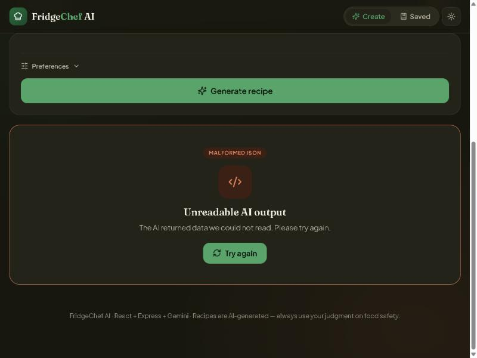
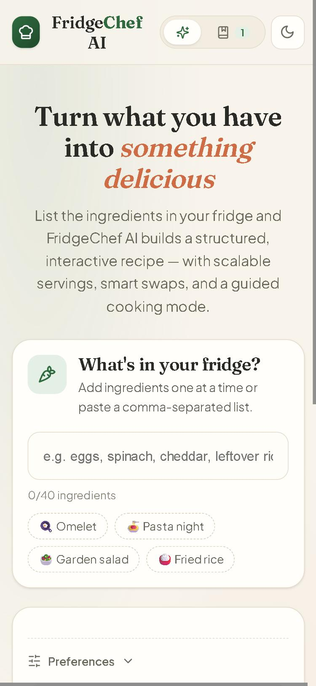
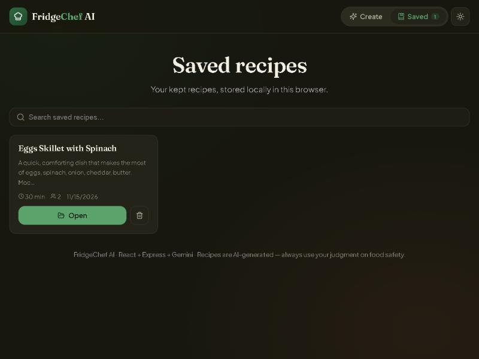
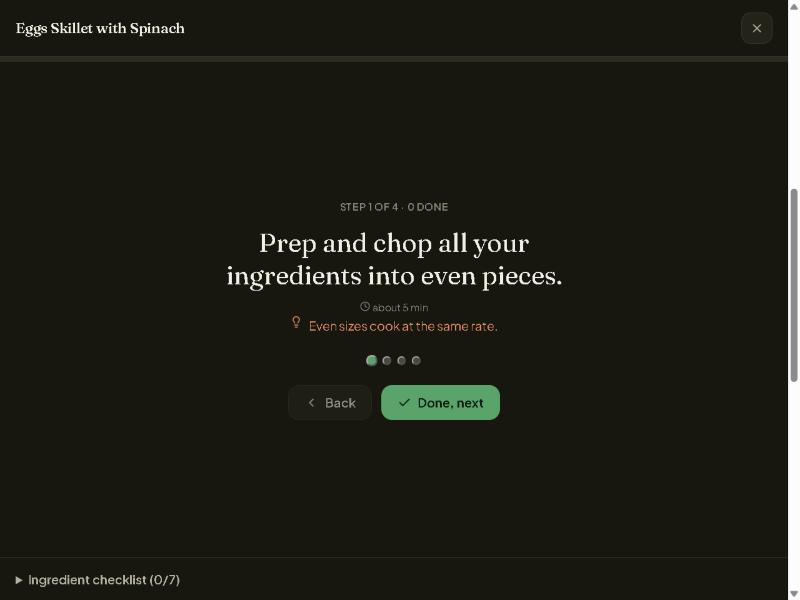

# 🥘 FridgeChef AI

**Turn what you have into something delicious.**

List the ingredients in your fridge and FridgeChef AI turns them into a **structured,
interactive recipe** — not a chat transcript. The AI returns strict JSON that the app
validates and renders as real components: a servings scaler that respects discrete vs.
continuous quantities, an ingredient checklist grouped by what you have vs. what you'll need
to buy, real ingredient substitutions with undo, a guided step-by-step **Cooking Mode**, and
locally-saved recipes.

The assignment's stated priority is **handling unpredictable AI output well** (20% of the
grade, and "what separates people who've built AI features from those who haven't"). That is
the heart of this project: a provider abstraction, a canonical schema, a strict validate →
normalize → safety-check pipeline, a correct HTTP error taxonomy, and tests for all ten
failure modes — none of which spend API credits.

---

## ✨ Features

**Core (assignment requirements)**
- Free-form **ingredient input** as chips: comma/Enter to add, remove, clear-all, duplicate
  prevention, normalization, max-count guard.
- **Real LLM integration** (Google Gemini) via a provider abstraction, with a deterministic
  **mock provider** so the whole app runs with no API key.
- **Structured output**: the model returns JSON constrained by a response schema; the server
  validates it against a canonical Zod schema and normalizes it before it ever reaches the UI.
- **Robust failure handling**: malformed JSON, wrong shape, empty, slow/timeout, rate limits,
  provider-down, auth failures — each maps to a correct status code and a safe, typed error
  card with a working **Retry**. The UI never crashes.
- **Stale-response protection**: `AbortController` + an incrementing request id guarantee an
  old response can't overwrite a newer one.
- **Loading, error, and empty states**; **responsive / mobile** layout.

**Product depth**
- **Accurate serving scaling** — discrete items (eggs) stay whole (min 1), continuous amounts
  (grams) scale smoothly and render as kitchen fractions (`1 1/2 cups`), qualitative amounts
  (“a pinch”) never scale. The base recipe is immutable, so scaling never compounds.
- **Real substitutions** — a dedicated `/api/recipes/substitute` endpoint; swaps are validated
  against your dietary exclusions, applied as an overlay, and reversible with **Undo**.
- **Dietary preferences & strict allergen exclusions** — enforced *server-side* by scanning
  the generated recipe (not just trusting the model), regenerating once on a violation.
- **Availability** — ingredients are grouped into *you have / you'll buy / pantry staples*,
  re-derived from your actual input rather than the model's optimistic claims.
- **Cooking Mode** — full-screen, step-by-step, progress bar, keyboard nav, per-step tips.
- **Saved recipes** — search, open, delete; persisted in versioned, validated `localStorage`;
  survives refresh. Cooking progress is persisted too.
- **Light & dark theme**; editorial food-tech design system.

---

## 🖼️ Screenshots

Captured from the running app on the mock provider (`docs/screenshots/`):

| Create (dark) | Generated recipe | Scaled 2→4 |
|---|---|---|
|  |  |  |

| Substitution + undo | Error handling | Mobile (light) |
|---|---|---|
|  |  |  |

| Saved recipes | Cooking mode | |
|---|---|---|
|  |  | |

> To reproduce: `npm start`, open http://localhost:3000, then generate a recipe, scale 2→4
> (note eggs stay whole while grams scale), swap an ingredient, and force an error by adding
> `fail:malformed` as an ingredient (**mock provider only**).

---

## 🧱 Technology stack

| Layer | Choice | Why |
|------|--------|-----|
| Frontend | React 18 + Vite 6, plain JS + JSDoc | TS is explicitly not graded; a shared **runtime Zod** schema gives the data-contract safety that matters. |
| Icons / styling | lucide-react, hand-written CSS design system | Minimal deps; full control of the look. |
| Backend | Express 4 (ESM) | Preserved the original's sound choice. |
| Validation | **Zod** (shared client + server) | One canonical schema; no drift. |
| AI | `@google/genai` (Gemini) behind a provider interface | Real provider + a credit-free mock. |
| Security | express-rate-limit, restricted CORS, body limits | See [Security](#-security). |
| Tests | Vitest + Supertest | Unit + backend failure-mode coverage, no API credits. |

## 🏗️ Architecture

```
          React (Vite) SPA
   chips + preferences + interactive recipe
                  │  POST /api/recipes/{generate,substitute}
                  ▼
            Express app (createApp)
   zod request validation → recipeService
                  │
     ┌────────────┴─────────────┐
     ▼                          ▼
 Provider abstraction     Trust pipeline (never trust the model)
 gemini │ mock            parse JSON → Zod validate → normalize
 (env-selected,          (assign IDs, renumber steps, re-derive
  injectable in tests)    availability, coerce quantities by kind)
                          → allergen scan (regen once) → safe recipe
```

Key idea: **the canonical Zod schema (`src/shared/recipeSchema.js`) is the single source of
truth**, imported by both the server and the client. The Gemini response schema is only a
generation *hint*; correctness is guaranteed by Zod validation + deterministic normalization
after the model responds.

Directory map:
```
src/
  shared/recipeSchema.js     canonical data contract (Zod) + request schemas
  lib/                       scaling, ingredients, format, storage, errors, api (pure, tested)
  hooks/                     useRecipeGenerator (abort+request-id), useSubstitutions, useTheme
  components/                UI (+ components/states for loading/error/empty)
server/
  app.js                     createApp({ provider }) — routes, middleware, central error handler
  index.js                   listen()
  config.js                  env (provider, model, CORS, limits, timeout)
  providers/                 gemini.js, mock.js, index.js, fixtures, geminiSchema
  lib/                       recipeService, normalize, allergens, availability, errors, prompt
tests/
  unit/                      scaling, ingredients, storage, normalize, errors
  server/                    api.test.js — all failure modes via injected providers
docs/                        PROJECT_AUDIT, IMPLEMENTATION_PLAN, TIME_LOG, HANDOFF
```

---

## 🚀 Installation & running locally

Requires Node 18+ (developed on Node 24).

```bash
npm install && npm start
```

That's it — `npm start` runs the backend + frontend together and **works with no API key**
(it auto-selects the deterministic mock provider when no real `GEMINI_API_KEY` is set). Open
**http://localhost:3000** (the Vite dev server proxies `/api` to the backend on 3001).

To use **real Gemini**, add a key first and `npm start` will auto-select it:

```bash
cp server/.env.example server/.env   # then edit server/.env and set GEMINI_API_KEY
npm start
```

Other scripts: `npm run build` (production build), `npm run preview`, `npm run server` /
`npm run server:mock` (backend only), `npm test` (all tests), `npm run test:watch`.

> Tip (**mock provider only**): force each failure path from the UI by adding an ingredient
> like `fail:malformed` (also `fail:timeout`, `fail:empty`, `fail:schema`, `fail:rate`,
> `fail:unavailable`, `fail:auth`) — handy for demoing error handling without the real API.

## 🔑 Environment variables

All backend-only (the key never reaches the browser). See `server/.env.example`.

| Var | Default | Purpose |
|-----|---------|---------|
| `AI_PROVIDER` | auto (`gemini` if key set, else `mock`) | Which provider to use. |
| `GEMINI_API_KEY` | — | Your key from https://aistudio.google.com/ (gemini only). |
| `GEMINI_MODEL` | `gemini-flash-latest` | A Google **rolling alias** so a retired model ID can't break us. Override with any current stable ID (e.g. `gemini-3.8-flash`, `gemini-3.5-flash-lite`). |
| `PORT` | `3001` | Backend port. |
| `REQUEST_TIMEOUT_MS` | `30000` | Upstream timeout before a `504`. |
| `CORS_ORIGINS` | `http://localhost:3000,http://127.0.0.1:3000` | Allowed origins. |

## 📡 API

All responses use one envelope: `{ success: true, data }` or
`{ success: false, errorType, message }`.

| Method & path | Body | Notes |
|---|---|---|
| `POST /api/recipes/generate` | `{ ingredients[], diets[], allergens[], maxTimeMinutes, difficulty, servings, cuisine }` | Returns a validated, normalized recipe. |
| `POST /api/recipes/substitute` | `{ ingredientName, recipeTitle, diets[], allergens[] }` | Dietary-filtered substitutes + a cross-contamination disclosure. |
| `GET /api/health` | — | `{ status, provider, providerConfigured }`. |

**Error taxonomy → status codes:** `INVALID_INPUT` 400 · `EMPTY_RESPONSE`/`MALFORMED_JSON`/
`SCHEMA_MISMATCH` 502 · `SAFETY_VIOLATION` 422 · `TIMEOUT` 504 · `RATE_LIMITED` 429 (+`Retry-After`)
· `PROVIDER_UNAVAILABLE`/`PROVIDER_AUTH` 503 · `INTERNAL` 500. Internal details (stack, provider
message, raw model text) are **never** sent to the client; a provider auth failure is never
surfaced as 401.

## 🤖 AI integration & structured output

- The backend calls Gemini with `responseMimeType: 'application/json'` and a response schema,
  so the model is nudged to emit structured JSON.
- That output is then **parsed → Zod-validated → normalized** before anything renders. The app
  trusts the Zod result, not the model: it assigns its own IDs, renumbers steps, re-derives
  availability from your real input, coerces quantities by `kind`, and scans for allergen
  violations (regenerating once).
- A **bounded retry** (one attempt) applies only to genuinely retryable failures
  (malformed/empty/schema/timeout/503/safety) — never to auth or rate-limit errors.

## 🧯 Error handling

Covered end-to-end and tested: malformed JSON, wrong shape, empty, timeout, 429, 503, auth
failure, unexpected exception, user cancellation, and **stale responses**
(`AbortController` + request-id). The frontend renders a typed error card with a working retry
and never crashes.

## 🧪 Testing

```bash
npm test
```

**All tests passing** — unit (scaling incl. fractional-egg prevention, ingredient parsing,
versioned/validated storage, server normalization, **allergen scanning in both directions** —
catches `cheddar`/`feta`/`buttermilk`, ignores `almond milk`/`peanut butter`), error
classification, and React component tests (chip add/dedupe/remove, error-card retry); backend
(Supertest driving every failure mode through injected fixture providers, asserting status
codes **and** that no internal detail leaks). No test touches the real API.

> Not done (per the PDF's optional stretch, and noted honestly): Playwright/E2E was not set up;
> component coverage is a focused subset, not exhaustive.

## 🔐 Security

API key stays server-side; restricted CORS; JSON body size limit; `express-rate-limit`;
ingredient count/length caps; user ingredients sent to the model as a JSON array (not
interpolated prose) to bound prompt injection; no `dangerouslySetInnerHTML`; errors never leak
internals; `.env` git-ignored with a committed `.env.example`. (Note: the repo's HawkScan hook
could not run — no `HAWK_API_KEY` — so this was done by hand, not that scanner.)

## ⚠️ Known limitations

- **The live Gemini path is implemented but not verified against the real API** — no key was
  available during development. It runs and is exercised end-to-end on the **mock** provider;
  set `GEMINI_API_KEY` to try it live. The current model is the `gemini-flash-latest` alias;
  set `GEMINI_MODEL` to a specific stable ID if you prefer.
- Allergen enforcement is **keyword-based** — a strong safety net, not a guarantee; the UI
  always shows a cross-contamination disclosure.
- Persistence is `localStorage` (single device/browser), per the MVP brief.
- After a substitution, step text still names the original ingredient; the swap is shown on the
  ingredient (with the original and an undo) rather than rewritten into every step.
- Stretch items intentionally **not** built: refinement loop, shopping list, photo/fridge scan,
  voice input, meal planning, nutrition estimates (see `docs/IMPLEMENTATION_PLAN.md`).

## 🧾 AI-usage disclosure

This project was built in an AI-assisted session using **Anthropic's Claude** (Claude Code).
Claude performed the repository audit, designed and wrote the new architecture (shared schema,
provider abstraction, trust pipeline, scaling/storage modules, the React UI and design system),
wrote the tests, and ran them. The design rationale is documented in `docs/` so the
implementation can be walked through, debugged, and extended; reviewing it before the interview
is part of the submitter's own work (see `docs/TIME_LOG.md`). In-app, the runtime LLM provider
is **Google Gemini** (`@google/genai`).


## 📜 Originality & attribution

This project **transforms a public reference repo**,
[`SIVANIKESH002/fridge-to-recipe`](https://github.com/SIVANIKESH002/fridge-to-recipe), rather
than claiming to be written from scratch. The original had no `LICENSE` file (so, by default,
all rights reserved); it is credited here and its provenance is disclosed openly.

**What was preserved / inspired by the original:** the overall product idea (ingredients →
structured recipe → interactive UI), the Express + Gemini + Zod stack choice, and — kept
because it was genuinely correct — the `AbortController` + request-id **stale-response
guard** pattern (re-implemented in the new hook).

**What was rebuilt (the substantial, independent work):** a single canonical shared schema
(replacing four duplicated ones); a provider abstraction with a mock; the whole error taxonomy
and failure-handling pipeline; server-side trust checks (ID assignment, step renumbering,
availability re-derivation, allergen enforcement); correct kind-aware scaling; real
substitutions with undo; versioned/validated persistence; the entire React UI, design system,
cooking mode, and saved recipes; and the full test suite. The redundant Streamlit `app.py`
copy was removed. See `docs/PROJECT_AUDIT.md` for the before/after in detail.
